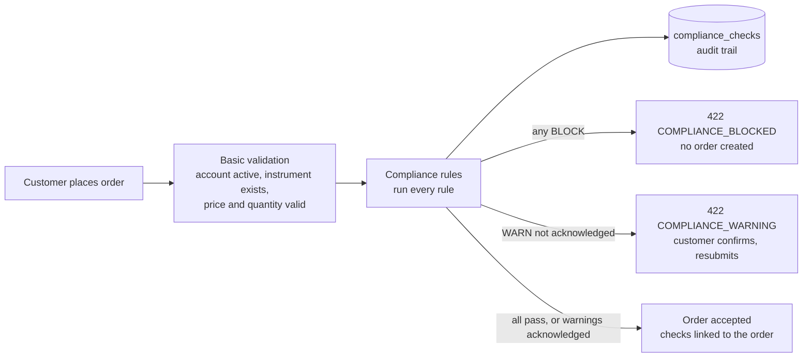

# Pre-trade compliance

Every order is checked against a set of rules **before it's accepted**. A rule can let the order through,
warn the customer, or block it, always with a plain-English reason. Every check is written to an audit trail,
including blocked attempts.

This is extension idea 10 from the brief: *"Stop bad trades before they happen, and show a clear reason why."*

## How an order is checked



The audit rows are saved in their **own transaction**, so they survive even when the order is blocked and its
transaction rolls back. When an order is accepted, its checks are linked to it in the order's transaction.

## The rules

Each rule is one class in `com.neueda.leap.compliance.rules` implementing `ComplianceRule` (strategy pattern).
They run in this order:

| Rule (`ruleId`) | Applies to | Outcome | Example reason |
|---|---|---|---|
| `RESTRICTED_LIST` | Buys | **Block** if the symbol is on the restricted list. Selling stays allowed so holders can exit. | You can't buy TSLA. It's on the restricted list: under internal compliance review |
| `CASH_AVAILABLE` | Buys | **Block** if cash, less what pending buys have reserved, doesn't cover the order | Not enough cash: this order needs $1,000.00, and $500.00 is available after your pending buy orders. |
| `HOLDINGS_AVAILABLE` | Sells | **Block** if shares held, less pending sells, don't cover the order | You can sell up to 1 AAPL shares: you hold 3 and 2 are already in pending sell orders. |
| `SINGLE_STOCK_LIMIT` | Buys | **Warn** above the profile's limit, **block** above its maximum (share of cash + holdings after the order). Portfolios under $1,000 are exempt. | After this order, NVDA would be 32% of your portfolio. The limit for a balanced risk profile is 25%. |
| `RISK_PROFILE` | Buys | Order value above the profile's limit: **block** for conservative, **warn** for balanced | This order is $30,000.00. Orders above $25,000.00 are outside a balanced risk profile. |

`CASH_AVAILABLE` and `HOLDINGS_AVAILABLE` replace the checks that used to sit directly in
`OrderService.placeOrder`. They behave the same, but they're now audited and give a clearer reason.

A rule that throws an error **blocks** the order ("We couldn't complete our pre-trade checks"), so nothing
trades unchecked.

### Risk profiles

Each account has a `risk_profile`; accounts without one are `BALANCED`. Admins change it on the **Compliance**
page. The limits are in `RiskProfile.java`:

| Profile | Single stock: warn above | Single stock: block above | Largest order |
|---|---|---|---|
| `CONSERVATIVE` | 10% | 20% | $5,000 (blocked above) |
| `BALANCED` | 25% | 50% | $25,000 (warning above) |
| `AGGRESSIVE` | 40% | 80% | No limit |

## API

`POST /api/v1/orders` takes an optional `acknowledgedWarnings` list. When an order is stopped, the response is
**422** with every reason:

```json
{
  "status": 422,
  "code": "COMPLIANCE_BLOCKED",
  "message": "You can't buy TSLA. It's on the restricted list: under internal compliance review",
  "reasons": [
    { "rule": "RESTRICTED_LIST", "outcome": "BLOCK", "message": "You can't buy TSLA. It's on the restricted list: ..." }
  ],
  "timestamp": "2026-10-17T12:00:00",
  "path": "/v1/orders"
}
```

For `COMPLIANCE_WARNING`, show the warnings, and if the customer confirms, resubmit the **same order with the same
idempotency key** plus `"acknowledgedWarnings": ["SINGLE_STOCK_LIMIT"]`. Acknowledging can never override a
block. Other order errors keep their existing 400 response.

## Data

| Table | Purpose |
|---|---|
| `restricted_instruments` | Symbols customers can't buy, with the reason shown to them. Seeded with **TSLA** for the demo. |
| `compliance_checks` | The audit trail: one row per rule per submission, with account, order details, outcome, reason, figures (`details`, JSON) and whether a warning was acknowledged. `order_id` is set when the order was accepted. `overridden_by` and `override_reason` are reserved for admin overrides. |
| `accounts.risk_profile` | `CONSERVATIVE`, `BALANCED` or `AGGRESSIVE` |

**Fresh databases** get these from `infra/db/migrations/04-pre-trade-compliance.sql` (run by the db image).
**Existing databases:** the app creates the tables and column on start (`ddl-auto=update`). Run the migration
once to add the TSLA demo restriction and the column default:

```bash
docker exec -i seaj_postgres_db psql -U "$POSTGRES_USER" -d "$POSTGRES_DB" < infra/db/migrations/04-pre-trade-compliance.sql
```

It's safe to run more than once.

Manage the restricted list and risk profiles on the admin **Compliance** page (below). The same in SQL:

```sql
INSERT INTO restricted_instruments (symbol, reason, added_by) VALUES ('META', 'pending corporate action', 'jay');
DELETE FROM restricted_instruments WHERE symbol = 'META';
UPDATE accounts SET risk_profile = 'CONSERVATIVE' WHERE account_id = 'ACC-0002';

-- The audit trail for one account, newest first
SELECT checked_at, symbol, side, quantity, rule_id, outcome, reason, acknowledged, order_id
FROM compliance_checks WHERE account_id = 'ACC-0002' ORDER BY checked_at DESC, id;
```

## Adding a rule

1. Create a class in `compliance/rules` that implements `ComplianceRule`, annotated `@Component` and
   `@Order(n)`.
2. Return `RuleResult.pass`, `warn` or `block` with a reason the customer will understand. Put the figures
   behind the decision in `details`.
3. Read only from the `OrderContext`. Rules must not query the database or change anything.
4. Add tests next to `ComplianceRulesTest`.

## Admin compliance page

Admins have a **Compliance** link in the header (`/admin/compliance`):

- **Recent checks:** one row per order submission, newest first: when, account, the order, the decision
  (Blocked, Needs acknowledgement or Allowed), the reasons from the rules that flagged it (marked
  *acknowledged* where the customer confirmed a warning), and whether an order was placed. Filter by decision,
  account ID or symbol.
- **Restricted list:** every restricted instrument with the reason customers see, and who added it and when.
  Add one (symbol and reason), or remove one (asks for confirmation first). Changes take effect on the next order.
- **Risk profiles:** every account with its profile and a summary of what each profile allows. Choose a profile
  and press **Save**; it applies from the account's next order. Closed accounts can't be changed.

This is the brief's showcase: try to buy TSLA as a customer, then open **Compliance** as an admin and show the
blocked row with its reason.

API, admin only (`ROLE_ADMIN`; customers get 403):

| Endpoint | Purpose |
|---|---|
| `GET /api/v1/admin/compliance/checks?decision=&accountId=&symbol=&limit=` | Newest submissions with every rule's result (`limit` up to 200, default 50) |
| `GET /api/v1/admin/compliance/restricted` | The restricted list, with instrument names |
| `POST /api/v1/admin/compliance/restricted` | `{"symbol":"META","reason":"…"}`. 404 if the instrument doesn't exist, 409 if already restricted. Recorded in the admin's name. |
| `DELETE /api/v1/admin/compliance/restricted/{symbol}` | Remove a restriction (404 if it isn't restricted) |
| `GET /api/v1/admin/compliance/risk-profiles` | Every account and its risk profile |
| `PUT /api/v1/admin/compliance/risk-profiles/{id}` | `{"riskProfile":"CONSERVATIVE"}`. Holds the account row lock used by order placement; 409 for closed accounts. Logged with the admin's username. |

## Audit events and metrics

Each submission also produces, in the same transaction as its audit rows (so blocked orders are included):

- **A Kafka event** on the `compliance-audit` topic, keyed by account ID, sent by the existing outbox relay:

  ```json
  {
    "eventId": "…", "eventType": "COMPLIANCE_CHECKED", "timestamp": "2026-10-19T12:00:00Z", "version": 1,
    "payload": {
      "checkGroupId": "…", "accountId": "ACC-0002", "symbol": "TSLA", "side": "BUY", "quantity": 1, "price": 200.00,
      "decision": "BLOCKED",
      "results": [ { "rule": "RESTRICTED_LIST", "outcome": "BLOCK", "reason": "You can't buy TSLA…", "acknowledged": false }, … ]
    }
  }
  ```

  `decision` is `BLOCKED`, `NEEDS_ACKNOWLEDGEMENT` or `ALLOWED`. View it in Kafka UI under the `compliance-audit` topic.

- **Metrics** (`ComplianceTelemetry`), recorded once the audit commits:
  - `seaj_compliance_decisions_total{compliance_decision}`: submissions by decision
  - `seaj_compliance_rule_results_total{compliance_rule, compliance_outcome}`: each rule's results

  The Grafana dashboard shows **Blocked by compliance** in its Trading row, and blocked submissions on
  **Orders over time**.

## On the order ticket

When the server stops an order, the ticket shows why, inside the ticket, after **Confirm**:

- **Blocked:** a red box headed *"This order can't be placed"* lists each reason. Confirm stays disabled until
  the order is changed (resending it unchanged would be blocked again).
- **Warning:** an amber box headed *"Check before you place this order"* lists each warning, with an *"I
  understand and want to place this order anyway"* checkbox. Ticking it enables **Place order anyway**, which
  resends the same order, with the same submission key, plus `acknowledgedWarnings`.
- Changing the order or going back to editing clears the box.
- Keyboard focus moves into the box (to the checkbox for a warning), because the disabled Confirm button would
  otherwise drop it. The box is announced to screen readers.

Code: `orders.ts` (`compliance`, `complianceStop()`), `orders.html`, `order-ticket.css`; tests in
`orders-compliance.spec.ts`.

## Still to come

- **Preview at the review step,** so warnings show before Confirm rather than after (a dry-run endpoint)
- **The checks on the order timeline,** so customers can see why an order of theirs was stopped
- **Admin override** of a block, recorded in `overridden_by` and `override_reason`
