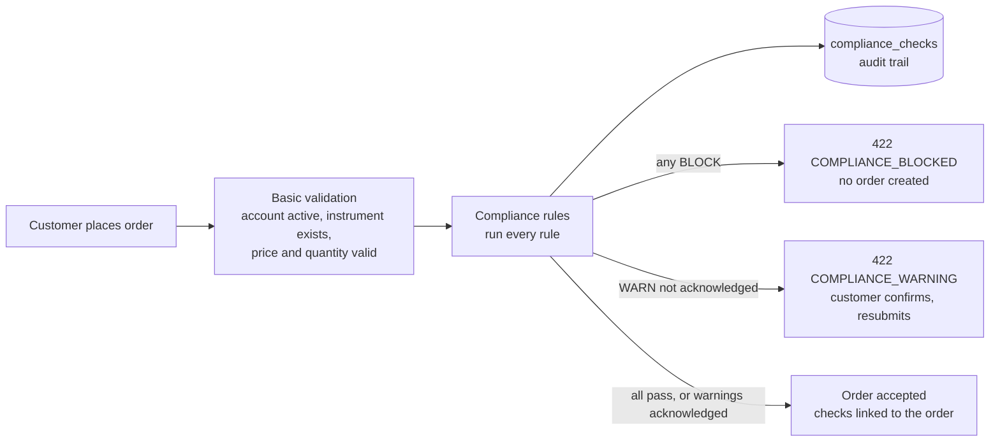

# Pre-trade compliance

Every order is checked against a set of rules **before it's accepted**. A rule can let the order through,
warn the customer, or block it, always with a plain-English reason. Every check is written to an audit trail,
including blocked attempts.

This is extension idea 10 from the brief: *"Stop bad trades before they happen, and show a clear reason why."*

## How an order is checked



The audit rows are saved in their **own transaction**, so they survive even when the order is blocked and its
transaction rolls back. When an order is accepted, its checks are linked to it in the order's transaction.

## The rules

Each rule is one class in `com.neueda.leap.compliance.rules` implementing `ComplianceRule` (strategy pattern).
They run in this order:

| Rule (`ruleId`) | Applies to | Outcome | Example reason |
|---|---|---|---|
| `RESTRICTED_LIST` | Buys | **Block** if the symbol is on the restricted list. Selling stays allowed so holders can exit. | You can't buy TSLA. It's on the restricted list: under internal compliance review |
| `CASH_AVAILABLE` | Buys | **Block** if cash, less what pending buys have reserved, doesn't cover the order | Not enough cash: this order needs $1,000.00, and $500.00 is available after your pending buy orders. |
| `HOLDINGS_AVAILABLE` | Sells | **Block** if shares held, less pending sells, don't cover the order | You can sell up to 1 AAPL shares: you hold 3 and 2 are already in pending sell orders. |
| `SINGLE_STOCK_LIMIT` | Buys | **Warn** above the profile's limit, **block** above its maximum (share of cash + holdings after the order). Portfolios under $1,000 are exempt. | After this order, NVDA would be 32% of your portfolio. The limit for a balanced risk profile is 25%. |
| `RISK_PROFILE` | Buys | Order value above the profile's limit: **block** for conservative, **warn** for balanced | This order is $30,000.00. Orders above $25,000.00 are outside a balanced risk profile. |

`CASH_AVAILABLE` and `HOLDINGS_AVAILABLE` replace the checks that used to sit directly in
`OrderService.placeOrder`. They behave the same, but they're now audited and give a clearer reason.

A rule that throws an error **blocks** the order ("We couldn't complete our pre-trade checks"), so nothing
trades unchecked.

### Risk profiles

Each account has a `risk_profile`; accounts without one are `BALANCED`. The limits are in `RiskProfile.java`:

| Profile | Single stock: warn above | Single stock: block above | Largest order |
|---|---|---|---|
| `CONSERVATIVE` | 10% | 20% | $5,000 (blocked above) |
| `BALANCED` | 25% | 50% | $25,000 (warning above) |
| `AGGRESSIVE` | 40% | 80% | No limit |

## API

`POST /api/v1/orders` takes an optional `acknowledgedWarnings` list. When an order is stopped, the response is
**422** with every reason:

```json
{
  "status": 422,
  "code": "COMPLIANCE_BLOCKED",
  "message": "You can't buy TSLA. It's on the restricted list: under internal compliance review",
  "reasons": [
    { "rule": "RESTRICTED_LIST", "outcome": "BLOCK", "message": "You can't buy TSLA. It's on the restricted list: ..." }
  ],
  "timestamp": "2026-10-17T12:00:00",
  "path": "/v1/orders"
}
```

For `COMPLIANCE_WARNING`, show the warnings, and if the customer confirms, resubmit the **same order with the same
idempotency key** plus `"acknowledgedWarnings": ["SINGLE_STOCK_LIMIT"]`. Acknowledging can never override a
block. Other order errors keep their existing 400 response.

## Data

| Table | Purpose |
|---|---|
| `restricted_instruments` | Symbols customers can't buy, with the reason shown to them. Seeded with **TSLA** for the demo. |
| `compliance_checks` | The audit trail: one row per rule per submission, with account, order details, outcome, reason, figures (`details`, JSON) and whether a warning was acknowledged. `order_id` is set when the order was accepted. `overridden_by` and `override_reason` are reserved for admin overrides. |
| `accounts.risk_profile` | `CONSERVATIVE`, `BALANCED` or `AGGRESSIVE` |

**Fresh databases** get these from `infra/db/migrations/04-pre-trade-compliance.sql` (run by the db image).
**Existing databases:** the app creates the tables and column on start (`ddl-auto=update`). Run the migration
once to add the TSLA demo restriction and the column default:

```bash
docker exec -i seaj_postgres_db psql -U "$POSTGRES_USER" -d "$POSTGRES_DB" < infra/db/migrations/04-pre-trade-compliance.sql
```

It's safe to run more than once.

Until there are admin screens, manage the list and profiles in SQL:

```sql
INSERT INTO restricted_instruments (symbol, reason, added_by) VALUES ('META', 'pending corporate action', 'jay');
DELETE FROM restricted_instruments WHERE symbol = 'META';
UPDATE accounts SET risk_profile = 'CONSERVATIVE' WHERE account_id = 'ACC-0002';

-- The audit trail for one account, newest first
SELECT checked_at, symbol, side, quantity, rule_id, outcome, reason, acknowledged, order_id
FROM compliance_checks WHERE account_id = 'ACC-0002' ORDER BY checked_at DESC, id;
```

## Adding a rule

1. Create a class in `compliance/rules` that implements `ComplianceRule`, annotated `@Component` and
   `@Order(n)`.
2. Return `RuleResult.pass`, `warn` or `block` with a reason the customer will understand. Put the figures
   behind the decision in `details`.
3. Read only from the `OrderContext`. Rules must not query the database or change anything.
4. Add tests next to `ComplianceRulesTest`.

## Still to come

- **Kafka audit events** (`COMPLIANCE_CHECKED` through the outbox) and a metric for the Grafana dashboard
- **UI:** warnings and blocks at the order review step, reasons on rejected orders, the checks on the order
  timeline, and an admin compliance page
- **Admin override** of a block, recorded in `overridden_by` and `override_reason`
- **Admin endpoints** for the restricted list and risk profiles
