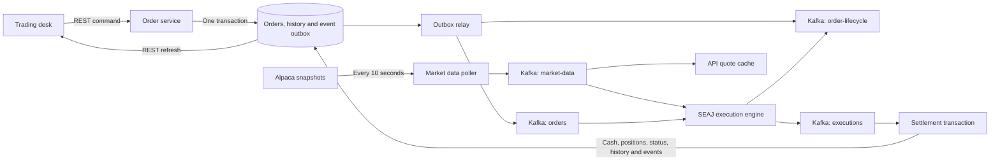

# Live-price order lifecycle

SEAJ's execution engine matches whole-unit orders against Alpaca bid/ask quotes delivered through Kafka. Account cash and positions remain in SEAJ's database. The engine does not submit orders to an Alpaca brokerage account.



## Topics and correlation

| Topic | Key | Contents |
|---|---|---|
| `market-data` | Instrument symbol | `PRICE_UPDATE`, bid, ask, last trade, original quote timestamp, `ALPACA_IEX`/`ALPACA_SIP` source, event ID |
| `orders` | Account ID | `SUBMIT`, `CANCEL`, `REJECT` commands, order ID, symbol, side, quantity, original price and order type |
| `executions` | Account ID | Fill report with execution ID, order ID, actual fill price, source, quote event ID, quote time and bid/ask used |
| `order-lifecycle` | Order ID | All persisted order transitions, engine receipt/waiting/match events, rejection reasons and settled portfolio changes |
| `orders.DLT`, `market-data.DLT`, `executions.DLT` | Source message key | Messages that cannot be processed, with failure headers |

Use `payload.orderId` or the key to filter `order-lifecycle` in Kafka UI. The quote's `eventId` is copied into the execution's `quoteEventId`, so the exact pricing input can also be located in `market-data`. Commands and reports use top-level `orderId`.

An immediately marketable order normally produces:

1. `ORDER_PLACED` — order recorded as NEW.
2. `ORDER_ACCEPTED` — local account, holdings and cash checks passed; order is PENDING.
3. `ORDER_RECEIVED` — execution engine received its Kafka command.
4. `TRADE_EXECUTED` — engine matched a fresh Alpaca quote and is sending its execution report.
5. `ORDER_FILLED` — database settlement committed.
6. `PORTFOLIO_UPDATED` — settled cash balance, position quantity and average cost.

A resting order also produces `ORDER_WAITING` with `WAITING_FOR_FRESH_ALPACA_QUOTE` or `LIMIT_PRICE_NOT_REACHED`. Repeated identical waiting states do not create an event on every quote. User cancellation produces `ORDER_CANCELLED` and a `CANCEL` command. Admin or settlement rejection produces `ORDER_REJECTED`, its actual reason, and a `REJECT` command. Database settlement is authoritative: an execution report alone does not mean that an order filled. Rejections at settlement leave cash and positions unchanged. Invalid or unauthorized HTTP requests that never create an order remain HTTP errors.

The old `trades` and `trade-events` topics remain available for historical/assignment compatibility. Their legacy state-changing listeners default to disabled (`trading.legacy-listeners.enabled=false`); the current order flow uses the topics above. Avoid enabling the legacy processors alongside the current flow.

## Matching and reliability

- Market buys use the live ask; market sells use the live bid. The estimate stored at submission does not cap a market order.
- Limit buys fill only at or below their original limit; limit sells only at or above it. Better prices come from the actual quote, without random price improvement or random delays.
- SEAJ stores money to cents. Asks round up and bids round down to cents before checking limits and settlement.
- Only quotes labelled `ALPACA_IEX` or `ALPACA_SIP` can execute. Quotes older than 60 seconds, more than five seconds in the future, crossed/zero quotes, and out-of-order replacements cannot create fills. Missing keys or an upstream outage never switch execution to demo prices. Outside active quote updates, orders wait.
- `order_event_outbox` is inserted in the same database transaction as placement, acceptance, cancellation, rejection or settlement. Failed transactions leave no publishable events. The relay reads at most 50 rows at a time, sends in ID order, waits for Kafka acknowledgements, and marks only acknowledged rows published. A failed send prevents later rows overtaking it.
- Kafka delivery is at least once. A crash after a Kafka acknowledgement but before the database commit can repeat an event with the same ID. Audit consumers should deduplicate `eventId`. Settlement locks the order/account and ignores duplicate fills or fills arriving after a terminal state, preventing duplicate cash/position updates.
- The engine acknowledges its audit records and execution report before returning to the listener. Waiting orders live in a book indexed by symbol. Pending database orders are requeued after at most about 40 seconds after an engine restart; repeated submissions are throttled to once per order per 30 seconds. Legacy NEW orders use the same durable recovery route after five minutes.
- There is one local engine instance. Scaling the engine horizontally requires shared or partition-aligned quote/book state; this setup does not claim a distributed matching book. Full fills are supported; liquidity/queue position, fees, partial fills and exchange trading sessions are not modelled.

The poller keeps the existing shared ten-second Alpaca snapshot cache; there is no second Alpaca client in the engine. Browser refreshes remain ten seconds. Scheduling has three threads so an outbox retry cannot stop price polling.

## Apply locally

Preserve the database volume. Apply the additive migration, then rebuild both Java services together:

```bash
docker-compose stop app execution-engine
docker exec -i seaj_postgres_db sh -c 'psql -U "$POSTGRES_USER" -d "$POSTGRES_DB" -v ON_ERROR_STOP=1' < infra/db/migrations/02-order-event-outbox.sql
docker-compose up -d --no-deps --build app execution-engine
```

For an older database that never received the order-type migration, also apply `infra/db/migrations/01-update-orders.sql` before starting the app. Fresh database builds include the outbox table. Existing private Alpaca API keys continue to be used only by the Java API; the engine needs no credentials.

To inspect events:

```bash
docker-compose up -d kafka-ui
```

Open `http://localhost:8090`, select `order-lifecycle`, and filter for the order ID. The same stream can be read from a terminal:

```bash
docker exec seaj_kafka kafka-console-consumer --bootstrap-server localhost:9092 --topic order-lifecycle --from-beginning --property print.key=true
```

Use `docker compose` instead if your laptop uses the Compose plugin. Full verification is `mvn test` in both Java projects. Engine tests use an isolated Kafka broker and fixture quotes, without touching user accounts. Outbox transaction tests use an in-memory H2 database and verify rollback, acknowledgement and retry persistence.

Alpaca's [snapshot API](https://docs.alpaca.markets/us/reference/stocksnapshots-1) and [quote schema](https://docs.alpaca.markets/us/docs/real-time-stock-pricing-data) describe the data source. The current integration deliberately retains polling at ten seconds.
