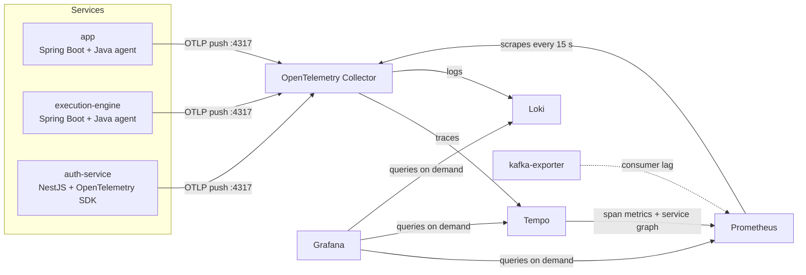

# Observability and the SEAJ dashboard

What we built for monitoring the SEAJ trading platform, why it's built this way, and what it can't yet tell
us. For starting the stack, see [infra/observability/README.md](../infra/observability/README.md).

## Summary

Every backend service sends **traces, metrics and logs** to one OpenTelemetry Collector. The collector forwards
them to Tempo, Prometheus and Loki, and Grafana shows them on one dashboard: **SEAJ Trading Platform**.

The dashboard is for a mixed audience. Read it top to bottom:

1. **Trading**: what customers are doing (orders, fills, value traded).
2. **Is the platform healthy?**: the four golden signals, in plain words.
3. **Reliability promise**: SLIs, SLOs, the SLA and the error budget, as taught in the SRE Principles module.
4. **Investigate** (collapsed): logs and traces for the technical audience.

## How telemetry flows

- **Services push** to the collector. Prometheus **pulls** metrics from the collector. Grafana stores nothing
  and asks each backend whenever a panel loads.
- Every log line carries the **trace ID** of the request it came from, so Grafana links log → trace → log.
- Telemetry is switched on by `OTEL_SDK_DISABLED=false` in `.env`. With it off, the services run as normal and
  send nothing.

| File | Role |
|---|---|
| `app/backend/backend-java/Dockerfile`, `execution-engine/Dockerfile` | Copy the OpenTelemetry Java agent into the image |
| `app/backend/backend-nestjs/src/observability/` | Starts the Node SDK, sends Nest logs to the collector, logs one line per request |
| `docker-compose.yml` | Turns the agent/SDK on, names each service, points it at the collector |
| `infra/observability/otel-collector.yaml` | Receives everything; routes traces → Tempo, logs → Loki, metrics → Prometheus |
| `infra/observability/tempo.yaml`, `loki.yaml`, `prometheus.yml` | Storage and retention (Tempo 48 h, Loki 7 days, Prometheus 30 days) |
| `infra/observability/grafana/provisioning/` | Data sources (pre-linked trace ↔ logs ↔ metrics) and dashboard loading |
| `infra/observability/grafana/dashboards/seaj-platform.json` | The dashboard |

## What each service sends

| Service | Traces | Metrics | Logs |
|---|---|---|---|
| **app** | Every API request, with its database queries and Kafka messages | HTTP rate and latency, JVM, connection pool, plus **business metrics**: orders placed, completed (filled / rejected / cancelled), time to fill, value traded | Application logs (account IDs masked) |
| **execution-engine** | Kafka consume and produce, database calls | HTTP, JVM, Kafka client | One line per order decision: received, waiting (with reason), filled, cancelled. No account IDs. |
| **auth-service** | Every request, with its Postgres queries | HTTP rate and latency (same metric names as Java) | One line per request (`POST /auth/login 401 12.3ms`), and 500 errors with their cause |
| **Kafka** (via kafka-exporter) | No | Consumer lag per group and topic | No |

Nothing records headers, request bodies or query strings, so passwords, codes, tokens and card numbers stay out
of telemetry.

**Not monitored:** nginx (frontend), the Postgres server itself and the Kafka broker. Their output stays in
`docker logs`. Request traces already show the database and Kafka time from the services' side.

## The dashboard

**Grafana:** http://10.9.65.95:8084 → *SEAJ Trading* folder → *SEAJ Trading Platform*. Defaults: today, refresh
every 30 s. The top bar has a **Service** filter and the **Availability SLO** dropdown.

### 1. Trading

| Panel | Meaning |
|---|---|
| Orders placed | Orders customers placed in the time range |
| Orders filled | Share of finished orders that filled (the rest were rejected or cancelled) |
| Orders rejected | Orders the platform turned down, for example for insufficient cash |
| Value traded | Quantity × price of filled orders |
| Average time to fill | Placed → filled. Limit orders wait for their price, so they pull this up. |
| Orders over time | Placed, filled, rejected and cancelled per interval |

These come from the business metrics in `OrderTelemetry.java` in app. Fills only happen in market hours, because
the engine fills against an Alpaca quote under 60 seconds old.

### 2. Is the platform healthy? (golden signals)

| Golden signal | Panel | Thresholds |
|---|---|---|
| Traffic | Requests per second | – |
| Errors | Requests failing (HTTP 5xx share) | Amber 1%, red 5% |
| Latency | Response time (p95: 95% of requests are faster) | Amber 300 ms, red 1 s |
| Saturation | Services running (3 of 3) | Red below 2, amber at 2 |

Charts below show traffic and response time per service. Click a line to filter to that service. The dots on
the response-time chart are sample requests; click one to open its trace.

### 3. Reliability promise (last 30 days)

This row always covers the last 30 days, whatever the time picker says.

| Panel | Meaning |
|---|---|
| Availability | The SLI over 30 days |
| Allowed downtime | The error budget in minutes |
| Downtime used | Failed share of requests × 43,200 minutes |
| Ship or stabilise? | *Ship* while budget is left; *Stabilise* once it's spent |
| Burn rate (last hour) | How fast budget is going: 1 = lasts exactly 30 days |
| Availability by service | Rolling-hour availability with the SLO (green) and SLA (red) lines |

### 4. Investigate (collapsed)

- **Recent warnings and errors** from all services, newest first. Expand a line and click **View trace**.
- **How the services connect**: the service map Tempo builds from traces.

## SLIs, SLOs and the SLA

Following the SRE Principles module:

| Term | Ours | Why |
|---|---|---|
| **SLI** (what we measure) | **Availability:** requests that did *not* return HTTP 5xx ÷ all requests | A 5xx means the platform failed. 4xx (wrong password, invalid order, expired session) is the user's mistake and doesn't count against us. |
| **SLO** (internal target) | **99.9%** over a rolling 30 days | The module's worked example. Selectable at the top (99.5 / 99.9 / 99.99) to show how each extra nine shrinks the budget. |
| **SLA** (external promise) | **99.5%** | Deliberately looser than the SLO, so we see slippage internally before the promise is at risk. **Illustrative**: SEAJ has no real contract. |
| **Error budget** | (100% − 99.9%) × 43,200 min = **43.2 minutes** per 30 days | The module's calculation. 99.99% would leave 4.32 minutes. |
| **Budget policy** | Budget left → ship features. Budget spent → reliability work first. | Shown as **Ship or stabilise?** |
| **Burn rate alert level** | 14.4 over 1 hour | The Google SRE Workbook's fast-burn threshold: at this rate, 2% of the 30-day budget goes in one hour. |

### Known limitations

These are worth knowing before presenting the numbers:

1. **A service that's completely down records no failures.** If app crashes, it stops sending metrics, so
   availability stays at 100% instead of dropping. **Services running** (2 of 3, red) is what catches this. A fix
   would be measuring from nginx or with a synthetic check (for example the Prometheus blackbox exporter).
2. **Request-based, shown as minutes.** The module counts downtime minutes. We measure failed requests and
   convert the share into minutes of the 30-day window. That's equivalent when traffic is steady, but only an
   approximation when it isn't.
3. **Low traffic makes the numbers jumpy.** With a handful of users, one failed request moves availability a
   lot. Background polling (the dashboard page refreshes every 2 s) makes up most requests, so it dilutes
   failures in important actions like placing an order.
4. **One SLI for the whole platform.** A better next step is an SLI per critical user journey, for example
   "orders placed successfully" (`POST /api/v1/orders`) and "logins that succeed".
5. **No latency SLO.** Response time has thresholds but no target. The module's example SLI, "% of requests under
   200 ms", could be added. The nearest histogram bucket is 250 ms.
6. **Thresholds don't follow the SLO dropdown.** Panel colours are fixed at 99.9 / 99.5, so they're only exact
   for the default SLO.

## What was done

| Change | Where |
|---|---|
| Monitoring stack in Docker: collector, Tempo, Loki, Prometheus, Grafana, kafka-exporter, behind the `observability` profile | `docker-compose.yml`, `infra/observability/` |
| OpenTelemetry Java agent in app and execution-engine | Their Dockerfiles, `x-otel-java` in compose |
| Business metrics for the order lifecycle | `app/.../observability/OrderTelemetry.java` |
| Traces, metrics and logs for auth-service (it sent nothing before) | `backend-nestjs/src/observability/`, `main.ts` |
| 500 errors in auth-service now logged with their cause (users still get a generic message) | `backend-nestjs/src/http.config.ts` |
| Order decision logging in the execution engine (it had none) | `execution-engine/.../OrderListener.java` |
| Memory fixes: Tempo was killed for running out of memory. Smaller trace blocks, Go memory limits on Tempo, Loki and Prometheus, a smaller collector queue, and Tempo raised to 512 MB | `tempo.yaml`, `otel-collector.yaml`, `docker-compose.yml` |
| Prometheus retention raised from 7 to 30 days for the SLO window | `docker-compose.yml` |
| The **SEAJ Trading Platform** dashboard | `grafana/dashboards/seaj-platform.json` |
| Low-memory start-up instructions | `infra/observability/README.md` |

### How it was checked

- Every dashboard query was run against Prometheus with live data. Trading, health, reliability and log panels
  all return data.
- **Orders filled** and **Average time to fill** still need a check during market hours, because no order has
  filled yet.
- auth-service has 5 new tests and the execution engine 4 new ones; all existing tests still pass.

## Extending the dashboard

- Edit `infra/observability/grafana/dashboards/seaj-platform.json`. Grafana reloads it within a minute. Changes
  saved in the Grafana UI are overwritten the next time the file changes, so copy them into the JSON
  (Dashboard → Share → Export).
- Keep the top three rows simple. Put technical detail in a **collapsed row at the bottom**. Candidates:
  - JVM memory: `jvm_memory_used_bytes`
  - database pool: `db_client_connection_count`
  - Kafka lag: `kafka_consumergroup_lag`
  - slowest endpoints: `http_server_request_duration_seconds` by `http_route`
- Use `$__rate_interval` in `rate()` queries, set a unit and a plain-language description on every panel, and
  filter by `service_name=~"$service"` so the Service dropdown works.
